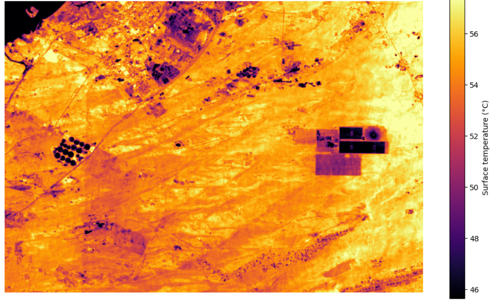

# THABAT — AI-Powered Road Resilience

## 1. Title and one-line summary

**Project:** THABAT  
**Theme:** Climate Resilience & Disaster Recovery  
**Country:** United Arab Emirates  
**PoC:** A reproducible satellite-data workflow that screens pre-segmented road corridors for unusual thermal behaviour and produces an inspection-priority ranking. The PoC is a screening aid, not a pavement-damage diagnosis system.

---

## 2. The business use case

**End user:** Road and infrastructure inspection / maintenance teams.

**Decision:** Decide which existing road segments should be prioritised for physical inspection when field time and inspection resources are limited.

**Current PoC workflow:** THABAT uses existing road segmentation from ArcGIS Pro and satellite-derived thermal evidence to produce a transparent screening priority for each segment.

**What the current evidence supports:** The repository demonstrates the screening workflow and the resulting ranking. A detailed account of the user's existing non-satellite workflow is not part of the current notebook evidence, so the PoC does not claim to replace any established maintenance process.

---

## 3. The problem

Road-surface conditions can be affected by environmental exposure, including heat and changing surface conditions. A practical Earth-observation workflow can help identify unusual road segments for closer inspection before field resources are deployed.

For this PoC, the road corridors are **already segmented in ArcGIS Pro**. The notebook therefore focuses on analysing segment-level thermal statistics rather than attempting to detect or delineate roads from satellite imagery.

### Why satellite data

Satellite observations provide repeatable spatial measurements over road corridors and can provide a consistent environmental screening layer. In this PoC, thermal data are used as **context and anomaly-screening evidence**.

### Important limitation

Thermal anomalies do **not** prove pavement damage, structural failure, or rainfall causation. The current evidence is a screening result and must be followed by additional dates, environmental data, and/or field engineering validation.

---

## 4. Data used

### Reproducible notebook inputs

| Dataset | Provider/source | AOI | Date | Processing / type | Resolution | Licence / sharing status | Role |
|---|---|---|---|---|---:|---|---|
| Landsat Collection 2 Level-2 surface temperature sample | USGS / Landsat | AOI-A | 2026-08-31 | Collection 2 Level-2 | 30 m thermal product grid | Verify current USGS terms before redistribution | AOI-A thermal context |
| AOI-A segment thermal statistics | ArcGIS Pro team export | AOI-A | Derived from project analysis | Segment statistics table | N/A | Team-derived table; verify public-sharing status | Segment-level input |
| AOI-B segment thermal statistics | ArcGIS Pro team export | AOI-B | Derived from project analysis | Segment statistics table | N/A | Team-derived table; verify public-sharing status | Segment-level input |

### Landsat temperature conversion

For the Landsat Collection 2 Level-2 `ST_B10` raster used in the notebook:

`Kelvin = DN × 0.00341802 + 149.0`

then:

`°C = Kelvin − 273.15`

DN `0` is treated as fill/no-data.

**Important:** this Landsat raster is an **AOI-A raster only**. It is not used as evidence of Landsat coverage over AOI-B.

### Other data sources explored during data selection

Sentinel-2, EnMAP, Tanager and ECOSTRESS were investigated as possible supporting sources. They are documented in `data/data_manifest.csv` and `docs/data_licence_and_security_log.md`; they are not presented as final notebook inputs unless their exact scene/product, coverage, quality and sharing status are confirmed.

The current manifest records:
- Sentinel-2 L2A: Copernicus Data Space;
- EnMAP HSI L2A: DLR / EOC Geoservice;
- Tanager open data: Planet Labs PBC;
- ECOSTRESS L2 LSTE: NASA ECOSTRESS;
- FGIC UAE 1 m imagery service as a high-resolution candidate.

Any source marked `VERIFY` or `CONDITIONAL` must not be treated as publicly cleared without confirmation.

---

## 5. Technical approach

The notebook executes the following workflow:

```text
Existing ArcGIS Pro road segments
              +
   ArcGIS-exported thermal
     segment statistics
              |
              v
      Input / quality checks
              |
              v
  Median LST + temperature range
              |
              v
   Robust standardisation
       z_median / z_range
              |
              v
Positive thermal anomaly + spread
              |
              v
    Screening priority score
              |
              v
 AOI-A and AOI-B tables/figures
```

### Segment-level features

For each segment the notebook uses:

- `t_min`
- `t_median`
- `t_max`
- `t_range = t_max - t_min`
- `valid_pixel_count`

### Screening score

The reproducible score is:

`priority_score = max(z_median, 0) + max(z_range, 0)`

This is an **inspection-priority screening score**, not a calibrated probability of pavement damage.

### Support flag

The notebook reports thermal-pixel support:

- `HIGH SUPPORT`: 30+ valid pixels
- `MEDIUM SUPPORT`: 10–29 valid pixels
- `LOW SUPPORT`: fewer than 10 valid pixels

These are reporting thresholds for transparency, not a statistical confidence model.

### AOI-specific handling

- **AOI-A:** Landsat thermal raster + AOI-A segment statistics.
- **AOI-B:** supplied AOI-B segment statistics only. The AOI-A Landsat raster is not used for AOI-B.

The current AOI-B table has only 2–3 valid thermal pixels per segment, so AOI-B results are explicitly treated as low-support.

---

## 6. Installation

Requires **Python 3.11**.

```bash
git clone https://github.com/DanaAlhammadi/Arab-Youth-Space-Hackathon-2026-813-Challenge.git
cd Arab-Youth-Space-Hackathon-2026-813-Challenge
python -m venv .venv
source .venv/bin/activate
pip install -r requirements.txt
```

On Windows PowerShell:

```powershell
.venv\Scripts\Activate.ps1
```

---

## 7. How to run

### Google Colab

Open:

```text
notebooks/01_thermal_screening.ipynb
```

The notebook is Colab-aware and automatically clones the repository when it detects Colab.

Then choose:

**Runtime → Run all**

No Google Drive mount, API key, token, or manual data path is required.

### Local Jupyter

```bash
jupyter lab notebooks/01_thermal_screening.ipynb
```

Then restart the kernel and run all cells.

### What to edit

**Nothing is required for the standard sample run.**

The notebook expects these files:

```text
data/sample_input/
├── AOI_A_Segment_LST_Stats_excel.xls
├── aoiB_Segment_stat.xls
└── Landsat_ST_AOI_Clip.tif
```

### Expected result

A successful run creates:

```text
results/
├── landsat_thermal_context.png
├── AOI_A_thermal_screening_summary.png
├── AOI_B_thermal_screening_summary.png
├── AOI_A_thermal_screening.csv
└── AOI_B_thermal_screening.csv
```

The submission repository should also contain the selected generated file:

```text
results/example_output.png
```

The exact runtime depends on the execution environment and I/O speed; the acceptance test is a clean restart-and-run-all with no errors.

---

## 8. Example input and output

### Example input

The notebook reads the supplied sample files from:

```text
data/sample_input/
```

The Landsat raster is the AOI-A thermal sample; the two Excel files provide the pre-segmented AOI-A and AOI-B thermal statistics.

### Example output

The notebook generates the thermal context map, segment-level tables and screening summaries under:

```text
results/
```

**Final repository requirement:** commit the real generated example output as:

```text
results/example_output.png
```

and show it here in the README:



If `example_output.png` has not yet been committed, this image will appear only after the final notebook run has generated and saved it.

---

## 9. Results and limitations

### Current result

For the current sample data:

- **AOI-A:** A-005 and A-001 have the highest thermal-screening priorities.
- **AOI-B:** B-002 has the highest thermal-screening priority.

These are **relative thermal screening results within each AOI**.

### Validation status

The current notebook provides internal data-quality checks and transparent reporting of valid-pixel support. It does **not** yet provide independent engineering ground truth proving that a high-priority segment is physically damaged.

### Where the approach breaks / limitations

- Thermal anomaly is not proof of pavement damage.
- A single date cannot demonstrate long-term deterioration.
- The current PoC cannot prove rainfall caused road deterioration.
- Thermal pixels can contain mixed road and surrounding land.
- AOI-B currently has only 2–3 valid thermal pixels per segment, so those results are low-support.
- The included Landsat raster is AOI-A only and must not be described as AOI-B coverage.
- The workflow does not diagnose cracks, potholes, rutting, or structural failure.
- Stronger validation requires multi-date observations, environmental/rainfall context, road-condition labels and/or field inspection.

### Safe claim

> THABAT uses satellite-derived environmental evidence to screen road segments and prioritize locations for physical inspection. Thermal anomalies provide contextual evidence; they do not independently establish pavement damage or causation.

---

## 10. Team, licence and attribution

### Team

The repository should list the final team members and their hackathon roles here before submission:

| Member | Role |
|---|---|
| Person 1 | Team / Integration Lead |
| Person 2 | EO / Hyperspectral Lead |
| Person 3 | AI / ML Lead |
| Person 4 | Materials / Validation Lead |
| Person 5 | Dashboard / Business Lead |

Replace the generic role labels above with the team's final names before submission.

### Data and attribution

See:

- `data/data_manifest.csv`
- `docs/data_licence_and_security_log.md`

These files record source, product/scene identity, dates, processing level, resolution, licence/sharing status, storage and decision.

### Security

Do not commit:

- API keys or access tokens;
- passwords;
- signed URLs;
- private account details;
- restricted/raw imagery that is not cleared for public redistribution.

Any dataset, image or derived product marked `VERIFY` or `CONDITIONAL` must remain subject to the corresponding licence/share-rights check.

---

## Repository structure

```text
THABAT/
├── README.md
├── requirements.txt
├── notebooks/
│   └── 01_thermal_screening.ipynb
├── data/
│   ├── data_manifest.csv
│   ├── study_areas/
│   └── sample_input/
└── results/
```
